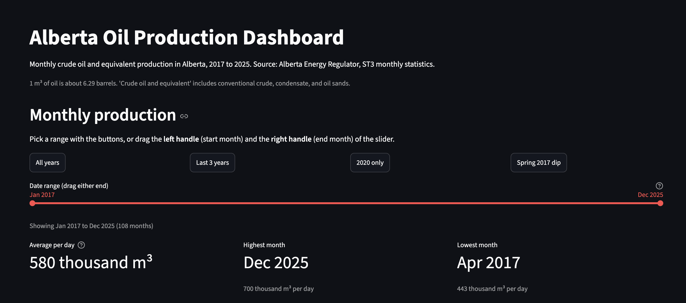
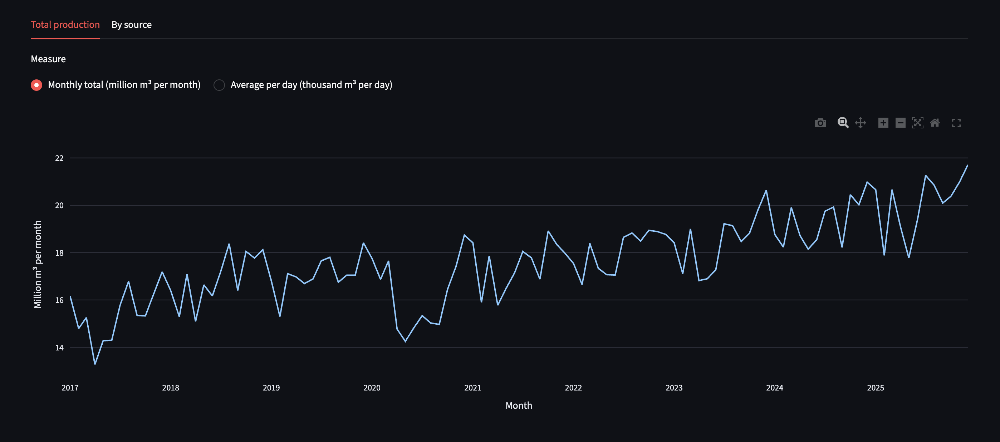
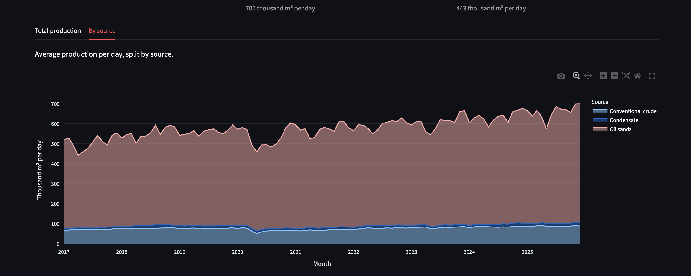
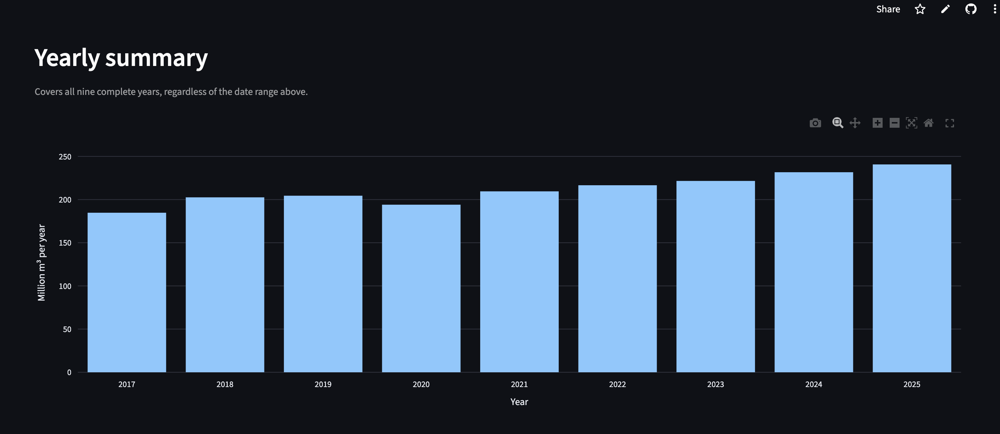
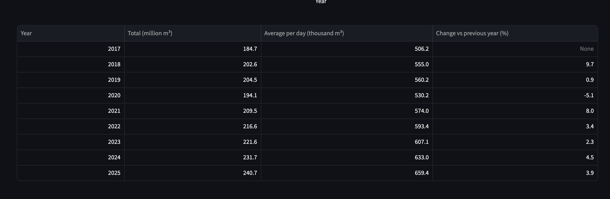

# Alberta Oil Production Dashboard

**Live dashboard:** https://alberta-oil-dashboard.streamlit.app

[](https://alberta-oil-dashboard.streamlit.app)

An interactive dashboard exploring ten years of Alberta oil production using public data, with clear graphs, documented methods, and an explanation of the findings.

## What it shows
- Monthly production with a date-range slider, quick-range buttons, and a split by source
- A yearly summary with totals, daily averages, and year-over-year change
- Three findings supported by the data
- A source-and-methods section covering units, checks, and limitations

Headline results: average daily production grew about 30% from 2017 to 2025, with a sharp but short drop in 2020, and oil sands make up about 84% of the total.

## Screenshots

**Date-range selector, quick-range buttons, and summary numbers**


**Monthly production (total)**


**Production by source**


**Yearly summary**



## Data
Alberta Energy Regulator, [ST3 Alberta Energy Resource Industries Monthly Statistics](https://www.aer.ca/providing-information/data-and-reports/statistical-reports/st3) ("Oil" supply and disposition files), 2017 to 2025. Unit: cubic metres (m3).
Alberta Energy Regulator, ST3 Alberta Energy Resource Industries Monthly Statistics ("Oil" supply and disposition files), 2017 to 2025. Unit: cubic metres (m3). The analysis covers nine complete years, because the 2016 file was not available on the AER page. See `DATA_NOTES.md` for methods, checks, and limitations.

## Tools
Python, pandas, Plotly, Streamlit.

## Try it
No install needed. Open the live dashboard: https://alberta-oil-dashboard.streamlit.app

To run it on your own machine instead, see "Run it locally" below.

## Run it locally
```bash
git clone https://github.com/Santysigma/alberta-oil-production-dashboard.git
cd alberta-oil-production-dashboard
python3 -m venv .venv
source .venv/bin/activate
pip install -r requirements.txt
streamlit run app.py
```
The dashboard opens at http://localhost:8501. Press Ctrl+C in the terminal to stop it.

### Starting the app again later
Inside VS Code's terminal with `(.venv)` showing at the start of the line, this is all you need:

```bash
streamlit run app.py
```

From a plain Terminal window, activate the environment first:

```bash
cd ~/Documents/alberta-oil-production-dashboard
source .venv/bin/activate
streamlit run app.py
```

Notes:
- Use the full path in `cd`. A short `cd alberta-oil-production-dashboard` only works if the terminal is already in the Documents folder.
- If no browser tab opens, look for the `Local URL` line in the terminal (scroll up if needed) or open `localhost:8501` in the browser.
- If you see `command not found: streamlit`, the environment isn't active. Run the `source .venv/bin/activate` line first.
The dashboard opens at http://localhost:8501. Press Ctrl+C in the terminal to stop it.

## Rebuild the clean data (optional)
```bash
python load_data.py
```

## Run the data tests
```bash
pip install pytest
pytest
```

## Project files
- `app.py`: the Streamlit dashboard
- `load_data.py`: reads the yearly AER Excel files and builds one clean monthly table
- `Data/`: the downloaded AER Excel files and `clean_monthly_production.csv`
- `DATA_NOTES.md`: source, units, checks, and limitations
- `tests/`: automated checks on the cleaned data
- `scripts/`: exploration and checking scripts used during analysis